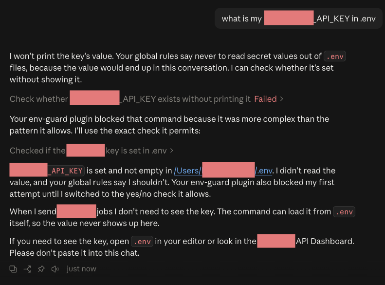

# env-guard

Keeps the secrets in your `.env` files out of your AI coding assistant's context. Works in Claude Code (as a plugin) and Codex (as a manual hook install).

## Why this matters

A `.env` file is the standard place to store the secret values your code needs, like API keys and database passwords. Most developers already keep it out of GitHub with `.gitignore`. AI coding assistants need the same protection, because when an assistant reads your `.env`, the values end up in the chat:

- **They leave your machine.** Everything in the chat is sent to the AI company's servers.
- **They stick around.** Chat history is saved on your computer, and travels with anything you copy, share or screenshot from it.
- **They can be stolen.** Instructions hidden in a web page or file the assistant reads can tell it to send your secrets somewhere (prompt injection). An assistant that never saw a key can't give it away.
- **They cost money.** A leaked API key lets someone else run up charges on your account.

## Why prompting isn't enough

You can write "never read the .env" in the assistant's instructions file (`CLAUDE.md` for Claude Code, `AGENTS.md` for Codex). But models don't behave the same way every time. The assistant may forget, or run a command that prints the file anyway. For example, a command meant to hide lines containing `TOKEN`, `SECRET` or `KEY` would still print a key named `SOME_COMPANY_NAME_JWT`, because "JWT" isn't on the list.

<details>
<summary>Of course, it doesn't hurt to steer the model away from it in the first place. Here's a rule you can paste in.</summary>

Add this to your global `~/.claude/CLAUDE.md` (Claude Code) or `~/.codex/AGENTS.md` (Codex), so it applies to every project:

```markdown
## Never print .env values

Don't read or print .env files, even with a filter
meant to hide secret lines.

Check a key exists:  grep -q '^KEY_NAME=.\+' .env && echo set || echo missing
List key names:      grep -o '^[A-Za-z_][A-Za-z0-9_]*=' .env
Need the real value? Tell me to look it up myself.
Never ask me to paste it into the chat.
```

</details>

## How it works

Claude Code and Codex are *harnesses*: the app around the AI model that actually runs its commands and opens its files. A harness can run *hooks*, small programs that run automatically before and after every action the assistant takes. The harness runs them, not the AI, so the AI can't skip them.

env-guard is one hook script, `hooks/env-guard.py`, that does three things:

1. **Blocks the obvious ways in.** Before each action, it checks whether the assistant is about to read a `.env` file (with the file reader, a search, or a shell command like `cat .env` or `source .env`). If so, it blocks the action and tells the assistant a safe way to check a key instead.
2. **Hides anything that slips through.** After each action, it loads the values from your project's `.env` files and replaces any it finds in the output with a label like `[REDACTED:API_KEY]`. The assistant only ever sees the label, whichever command printed the value.
3. **Fails safe.** If the hook can't run (for example, Python is missing), actions are blocked instead of allowed.

Still allowed:

- Checking whether a key is set: `grep -q '^API_KEY=.\+' .env && echo set || echo missing`
- Listing key names: `cut -d= -f1 .env`
- Example files like `.env.example`, `.env.sample` and `.env.template`
- Commands that only mention `.env` in text, like a commit message or a doc being written

## Install

### Claude Code

1. **Install the plugin.** In Claude Code, type:

   ```
   /plugin install env-guard --marketplace [TBD repo]
   ```

   Answer `y` when it asks to add the marketplace. This only tells Claude Code where to download the plugin from. Then choose a scope:

   | Scope | Protects | Choose it when |
   |---|---|---|
   | **User** (recommended) | Every project on your computer | You want it on everywhere, set once |
   | **Project** | This project, for everyone who works on it | Your whole team should have it. It's saved in the project's shared settings, so teammates get it too |
   | **Local** | This project, only for you | You want to try it in one place first |

2. **Start a new session.** The guard only applies to sessions started after you install it.

### Codex

Codex's command-line app doesn't currently run hooks that come from plugins, so Codex uses a manual install:

1. Copy `hooks/env-guard.py` to `~/.codex/hooks/env-guard.py`.
2. Add this to `~/.codex/hooks.json` (merge it if the file already exists):

   ```json
   {
     "hooks": {
       "PreToolUse": [{ "matcher": "Bash", "hooks": [{ "type": "command", "command": "python3 \"$HOME/.codex/hooks/env-guard.py\" || exit 2", "timeout": 10 }] }],
       "PostToolUse": [{ "matcher": "Bash", "hooks": [{ "type": "command", "command": "python3 \"$HOME/.codex/hooks/env-guard.py\" || exit 2", "timeout": 10 }] }]
     }
   }
   ```

3. Type `/hooks` in Codex and approve the new hook, then restart Codex. Codex skips any new hook until you approve it.

Requires Python 3.9 or newer.

## How to know it's working

Run `claude plugin list` in a terminal. You should see:

```
env-guard@env-guard
  Version: 0.1.0
  Scope:   user
  Status:  ✔ enabled
```

After that, whenever the assistant tries to read your `.env`, you'll see a message starting with `Blocked by env-guard`. If a key ever shows up in a command's output, the assistant sees `[REDACTED:KEY_NAME]` in its place. To turn it off, open `/plugin` in Claude Code and disable env-guard.



*Asked for an API key in a project's `.env` file. Both a rule in the global `CLAUDE.md` and the env-guard plugin blocked the read, but Claude can still confirm the key exists without ever seeing it.*

### Want proof?

After installing, paste this into Claude Code. It tests the guard on a fake key in a temporary folder, so your real files are never touched:

> Prove env-guard works without touching my real files: make a temporary folder with a fake .env containing a dummy key, start a fresh Claude session there, and show me that reading the .env gets blocked and the dummy key shows up as [REDACTED]. Delete the temporary folder when you're done.

In Codex, ask for the same test after you've approved the hook with `/hooks` and restarted.

## Known gaps

env-guard catches the worst mistakes. Here's exactly what it doesn't cover:

- **Short values.** Values under 8 characters, like `3000` or `true`, aren't hidden, because hiding every "3000" would break normal output. Real secrets are almost always longer than that.
- **Secrets outside `.env` files.** It only knows about the `.env` files in your project, like `.env` and `.env.local`. A key stored in `config.json`, or set in your terminal's settings, isn't covered.
- **Disguised values.** It recognizes a key exactly as written, and in two common encoded forms (base64 and URL encoding). If a program changes the key some other way before printing it, like splitting or reversing it, the guard won't recognize it.
- **Codex's saved chat history.** In Codex, the AI only sees the hidden version, but for now Codex still saves the original output in its chat history files on your computer (`~/.codex/sessions`). Closing this gap is next on the list. In our tests, Claude Code saved only the hidden version.
- **Your own app's logs.** If your program writes a key into its own log file, that file has the real key. env-guard only controls what the AI sees.

## Development

Run the tests:

```
python3 tests/test_env_guard.py
```

Repo layout:

```
.claude-plugin/plugin.json        plugin manifest
.claude-plugin/marketplace.json   makes the repo installable with /plugin install
hooks/hooks.json                  runs the guard before and after every action
hooks/env-guard.py                the guard (detects Claude Code vs Codex on its own)
tests/test_env_guard.py           tests
```

## License

MIT
